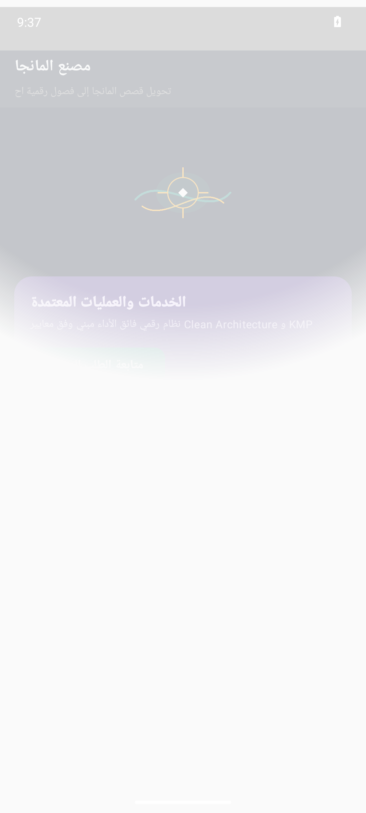

# مصنع المانجا (Manga Factory)


-orange?style=flat)


> **تحويل قصص المانجا إلى فصول رقمية احترافية**

---

## Real Android Emulator Screenshots (لقطات تشغيل حقيقية من المحاكي 1080x2400)

| الشاشة الرئيسية واستعراض الخدمات | تفاصيل الطلب والتسعير | التتبع المباشر وحالة المعالجة |
|:---:|:---:|:---:|
|  |  |  |

---

## Project Overview (نظرة عامة على المشروع)

تطبيق مصنع المانجا هو منصة رقمية متكاملة تخدم كتاب المانجا المحترفين، حيث توفر أدوات متقدمة لتحويل قصصهم إلى فصول رقمية جذابة. يتميز التطبيق بواجهة سهلة الاستخدام، وأتمتة عمليات الإنتاج الفني، وبوابة دفع إلكتروني آمنة. كما يوفر التطبيق ميزة التتبع اللحظي للطلبات وإرسال الإشعارات الفورية للمستخدمين. يهدف التطبيق إلى تعزيز نمو أعمال كتاب المانجا من خلال تبسيط عملية الإنتاج وزيادة المبيعات.

---

## Core Features (المميزات الرئيسية)

- **تحويل قصص المانجا إلى فصول رقمية جذابة**
- **أتمتة عملية الإنتاج الفني وتقليل الوقت والجهد**
- **بوابة دفع إلكتروني آمنة ومتكاملة مع الضرائب**
- **تتبع لحظي للطلبات وإشعارات فورية للمستخدمين**

---

## Clean Architecture Layers

```
sa.manga.factory
├── data/
│   └── MangaChapterRepository.kt          # Flow-based reactive data source
├── model/
│   └── MangaChapterModels.kt              # Immutable business data structures
└── ui/
    ├── MainActivity.kt                # Jetpack Compose Entry Activity
    ├── MangaChapterViewModel.kt           # StateFlow UI state holder
    └── MangaChapterScreens.kt             # Material 3 Compose vector screens
```

---

## Architectural Invariants & Security Threats

### Invariants (القواعد الصارمة):


### Threat Model (حماية البيانات والتهديدات):


---

## Build Instructions

```bash
# Clone the repository
git clone https://github.com/hmoushim0-cloud/app-1289352.git
cd app-1289352

# Assemble Debug APK
./gradlew :app:assembleDebug
```

---

### Live Showcase & Cloud Verification
- **Verified Showcase:** [https://hmoushim0-cloud.github.io/live-previews/?id=1289352](https://hmoushim0-cloud.github.io/live-previews/?id=1289352)
